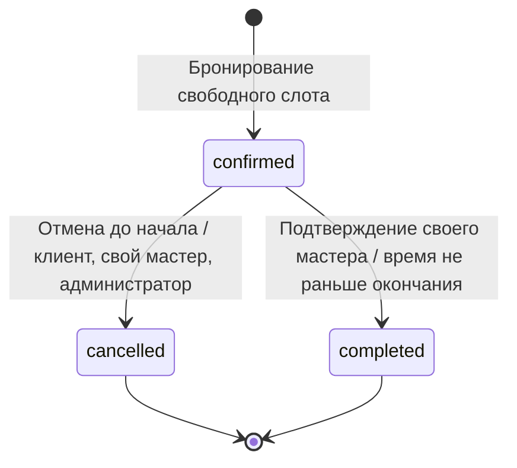

# Состояния встречи: клиент и мастер

Доработка выполнена в `redesign-booking-flow` по документу «Следующий этап улучшения студенческих проектов.docx».

Состояния для обоих кабинетов рассчитывает сервер. Кнопка завершения появляется только у назначенного мастера при `now >= starts_at + duration`. Пока встреча идёт, указан точный момент, с которого разрешено завершение. Клиент получает возможность оставить отзыв только после подтверждения мастера.



Внутри `confirmed` отображаются «Предстоит» → «Идёт встреча» → «Ожидает завершения». Это временные фазы одного состояния, а не автоматическое подтверждение оказанной услуги. Неявка остаётся ожидающей решения, перенос до начала выполняется отменой и новой записью. Подробные ограничения описаны в [README](../../README.md#завершение-встречи-и-правила-статусов).

## Скриншоты

| Состояние | 390 px | 1280 px |
|---|---|---|
| Клиент: встреча идёт, нет отзыва и отмены | [PNG](screenshots/client-in-progress-390.png) | [PNG](screenshots/client-in-progress-1280.png) |
| Мастер: встреча идёт, указано время доступности завершения | [PNG](screenshots/master-in-progress-390.png) | [PNG](screenshots/master-in-progress-1280.png) |
| Мастер: наступило окончание, можно завершить | [PNG](screenshots/master-ready-390.png) | [PNG](screenshots/master-ready-1280.png) |
| Клиент: встреча завершена, отзыв отправлен | [PNG](screenshots/client-completed-390.png) | [PNG](screenshots/client-completed-1280.png) |

Снимки сделаны Playwright на работающем Flask API. Время намеренно переключается на тестовом сервере, чтобы пройти часовую услугу без ожидания часа; производственный сервер не содержит такого маршрута. Клиент и мастер используют отдельные браузерные сессии, реальные запросы к API и одну временную базу. В сценарии также проверяются HTTP 409 для раннего/повторного завершения и HTTP 403 для преждевременного отзыва. Существующая пользовательская база не меняется.

Повторить сценарий и обновить изображения:

```bash
CAPTURE_LIFECYCLE=1 CHROMIUM_PATH=/usr/bin/chromium npx playwright test tests/browser/lifecycle.spec.js
```

Проверки: 52 серверных теста и 13 браузерных сценариев, включая прежние сценарии записи, модерации, расписания и редизайна.
